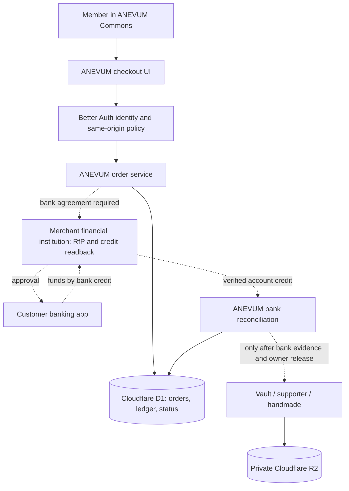

# ANEVUM Commerce V001 — bank-authorized customer journey and technical design
Date: 2026-10-26
Scope: ANEVUM's own first-party supporter options, Creator Vault upgrades, and founder/girlfriend-made Cricut merchandise.
Status: DRAFT ENGINEERING DESIGN. Real payments: OFF. Merchant account: NOT VERIFIED.

## Nonnegotiable product principles
1. ANEVUM owns the experience, prices, private order records, receipt/history, reconciled journal, entitlements, inventory and fulfillment.
2. ANEVUM does NOT act as a bank, money transmitter, card acquirer or interbank settlement network, and must not collect or store consumer bank usernames/passwords, debit-card numbers, card CVVs or bank credentials. The bank must provide a contractual merchant integration where required.
3. No money collection, preorders, tips or paid storage activation until the entire stack and bank-specific legal/payment capabilities have passed real-world acceptance and founder go/no-go.
4. No third-party checkout/merchant marketplace or outsourced physical merch. Bank participation is necessary for actual USD settlement.
5. Keep the existing Commons/Creator Studio infrastructure, visual theme, member identity, and #325/#308 priorities. This PR is review-only; no production migration or deploy.

## Financial institution feasibility — evidence versus inference
- Federal Reserve: FedNow is an FI-only payment network; there is no FedNow consumer app, and bank participation/customer features vary: https://www.federalreserve.gov/paymentsystems/fednow_faq.htm
- FedNow RFP `pain.013` requests require FI participation; accepting an RFP causes a *separate* customer credit transfer `pacs.008`, not money movement from the RFP alone: https://www.frbservices.org/binaries/content/assets/crsocms/resources/rules-regulations/021326-fednow-service-operating-procedures.pdf
- U.S. Bank's customer-facing RfP billpay shows payment requests, approve/dismiss, bank notifications, and scheduled/instant pay: https://www.usbank.com/customer-service/knowledge-base/KB0235799.html
- PNC describes RfP presentation inside its mobile banking app: https://www.pnc.com/content/dam/digital-assets/en/documents/digital_services_agreement.pdf
- J.P. Morgan documents direct bank APIs for Request for Payment and payment receipt webhooks: https://developer.payments.jpmorgan.com/docs/home — products may require treasury/business contracts, underwriting, eligibility, commercial terms and integration access. Documentation **does not prove** ANEVUM is eligible.
- Any QR/link product must be bank-supported for the relevant U.S. rails and payer banks; do NOT treat a sample QR as a live payment request. Some published QR routes are market-specific, not automatically available in the U.S.
- A direct-merchant banking agreement does not make the financial institution optional and may include minimum fees beyond a small creator platform's budget.
- An unsupported bank must result in “Not available,” not a fake fallback that silently becomes a wire transfer.

## Primary customer journey (conditional on eligible bank support)
1. Member signs into existing ANEVUM account and chooses one item (or review-only basket once implemented).
2. Server validates known product ID, exact price/currency, taxes/delivery terms, stock, quotas and a new opaque order reference. Idempotent create; no client-supplied user ID or settlement status.
3. Server checks ANEVUM merchant account and payer-bank coverage through an approved bank capability API. No assumptions from routing number alone.
4. **Bank-authorized request** (RfP/approved bank deep link) is created by signed server-to-bank call only when bank-supported and owner-live-authorized. Never embed bank access tokens or raw account numbers in browser state.
5. Customer receives bank notification or opens verified bank-hosted approval. On mobile, return to ANEVUM; desktop may show bank-supported QR only if real bank documentation supports that U.S. flow. Customer can decline/cancel/time out.
6. ANEVUM shows “Awaiting bank confirmation” while reconciling. **RfP delivered/accepted alone is not proof of settled funds.**
7. Independently verified merchant-account incoming credit has unique bank event ID, verified beneficiary account, reference, amount, currency and posting status. Callback authentication + independently queried bank record where supported, with replay/idempotency and access audits. Invalid, partial, multiple or mismatched credits enter exception review; do not auto-fulfill.
8. Atomically enter journal records and create exactly one fulfillment: storage 30-day pass, supporter contribution receipt/recognition (not XP), or Cricut-manufacturing queue item. A receipt contains real transaction evidence and terms.
9. Customer can view bank-approved, bank-confirmed, pending, declined, expired, refund-under-review and refunded states. Avoid 'instant' promises unless network and bank genuinely confirm.
10. Refund/reversal/expiry, tax records, data retention, member export/deletion and recovery are tested before any live money.

## UX designs and edge states
- Private route `/me/commerce` shares current Commons and member auth, uses dark slate/terminal aesthetic, selection of known catalog items and a read-only bank explanation. Currently uses **no active purchase button** or real bank chooser.
- **Payer bank unsupported:** explain payment unavailable. Do not ask the customer to email routing numbers or send a screenshot.
- **Bank authorization canceled:** return to order review; no entitlement or charge.
- **Bank callback delayed or lost:** show pending; retry trusted server query. Never rely on front-end “success” redirect.
- **Duplicate bank event:** uniquely key by merchant account/institution/transaction ID and idempotent order/event relation.
- **Amount/reference mismatch:** reconciliation exception queue; never auto-credit another user.
- **Bank credit received after order expiry:** manual exception; safe refund path reviewed.
- **Refund request:** bank-side return of funds via an approved rail or properly authorized process, preserve audit. No automatic refund claim before actual bank evidence.
- **Storage pass expires:** advance warnings, download/read-only grace before purge, retention legal checks.
- **Handmade merch:** physical stock and time commitments required, no preorders while payment blackout, shipping only by founder/girlfriend, sales-tax posture reviewed.
- **Accessibility:** mobile-first, keyboard-focussable steps, large tap targets, errors and pending updates announced, reduced motion, never rely on color alone.
- **Privacy:** no bank institution/payment enrollment data available via member public profile; third-party bank consent/privacy handled under approved contract.

## Reference architecture

## Domain contracts
- Owned identifiers: `order_id` UUID, immutable verified `user_id`, `product_code`, `amount_cents` integers, currency USD, idempotency key scoped to session, opaque external settlement reference, unique bank-credit ID.
- Real-money state machine **future only**: `draft` → `request_created` → `awaiting_bank` → `bank_credit_verified` → `fulfilled`; branches `declined`, `expired`, `exception`, `refunded`. Never derive a paid state from customer interface or signed-in staff manual field alone.
- Operational path before approval: only **draft/read-only catalog** with a hard `checkoutEnabled=false`, `canFulfillPaidOrder=false` and SQL blackout triggers.
- Bank adapter (future) exposes: `getCapabilities`, `createRequest`, `getRequestStatus`, `verifyIncomingCredit`, `issueRefund`; capabilities and currency/rail are explicit, no bank credentials in browser; every API operation has timeouts, idempotency, audit and access controls.
- Quote expiration differs from payment-request expiration. Timezone/clock skew must be explicit and server controlled.
- A posted bank credit must be bound to an eligible, previously issued ANEVUM request; matching alone does not prove provenance.
- Journal must be double-entry, atomic, immutable with reversible postings rather than overwrites and a daily bank-statement reconciliation. `commerce_journal_lines` has preview-only structures; blocked real posting must not be weakened prematurely.
- Strict separation: first-party payments only. Creator-to-creator commissions, third-party seller payouts and user-held balances are NOT included and may require a different regulated product.

## Bank evaluation criteria (collect facts, don't initiate contact automatically)
Bank candidate must answer *all* of these, with documentary evidence:
- Is ANEVUM eligible as a sole proprietor / existing registered business, at actual projected volume?
- Does the bank allow us to **originate** RfP, not merely receive payments, and offer a merchant API for it?
- Which U.S. customer banks can receive a request today? How is payer eligibility checked **before** checkout?
- Can the payer authorize in their banking app without a bank-login collection by ANEVUM? Is QR/deep-link part of the specific U.S. product?
- Which fields are provided on a credited bank transaction, and can they be queried independently from webhook delivery?
- How are authenticated callbacks signed or protected, how do we handle lost/duplicate messages, and what are production API limits?
- Does it support merchant refunds, exception/return workflows and customer disputes? Who bears losses?
- What are account fees, monthly minimums, per-RfP fees, incoming credit fees, API charges, and onboarding deposits?
- Are there volume/transaction minimums incompatible with $4–$25 products?
- What is the legal/compliance position on supporter contributions, digital storage, handmade merchandise and future independent creator payouts?
- Is direct developer sandbox access included without opening a commercial merchant account first?

## Releases and acceptance
**Milestone A — current:** owned catalog, paid-off, synthetic bank matcher/journal, draft D1 schema and user-selectable UI preview. No money.
**Milestone B — build next:** private Creator Vault files/projects, authenticated unpaid order history and administrator synthetic bank exception queue. Review-only SQL until isolated data controls/backup.
**Milestone C — depends on actual bank:** underwriting/business eligibility, API credentials in protected environments, end-to-end zero-dollar capability checks where bank permits, authentic callback and bank readbacks, refund handling and legal/tax review.
**Milestone D — owner go/no-go:** independent A/staff/B checks, fraud/backups/restore, accessibility and mobile coverage, real financial reconciliation and price economics before enabling actual charges.

### Practical decision
If a business bank will not support a convenient customer-approved RfP/API at an affordable cost, **do not** ship high-friction manual wire/ACH transfers as the default micro-payment checkout. The approved no-payments-until-ready policy takes precedence.
